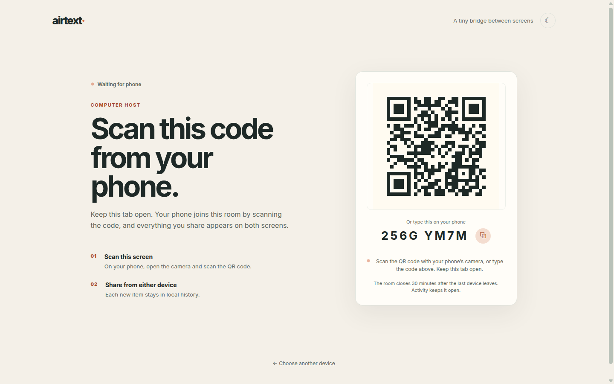

# airtext

A small clipboard bridge between a computer and a phone. Open the app on the computer, scan its QR code from the phone, and share text between both screens.

**→ Try the live demo: [airtext.alkaiyali.com](https://airtext.alkaiyali.com/)** (camera access recommended for QR pairing)



## How pairing works

1. Choose **Use this computer**. A temporary room opens automatically and displays a QR code plus an 8-character fallback code.
2. Choose **Use this phone** on the phone, scan the QR, or enter the fallback code.
3. After both browsers show **Connected**, share text from either composer.
4. Each browser keeps its own bounded history in IndexedDB, scoped to the current room — a new session starts with a clean trail. Nothing is associated with an account.

## Privacy and limits

- Room codes are temporary bearer capabilities. Leave the room or start over to invalidate the current connection.
- Invite links carry the room code in the query string; codes are short-lived bearer tokens that expire with the room.
- Only two browser connections are allowed in a room (max 4 sockets briefly during reconnect overlap; unidentified sockets are closed after 10s).
- Clipboard text is sealed on-device with AES-GCM under ephemeral ECDH (P-256) session keys before relay, forwarded to the other live browser, and never persisted by the Worker. The room code is only the rendezvous name — it cannot decrypt anything, and keys are discarded when you leave (forward secrecy). The relay still sees metadata (timing, size, IPs): treat rooms as private, not anonymous.
- Each screen shows a **match check** code once the secure channel is up. If both screens show the same code, no one is sitting in the middle; if they differ, leave the room and start over.
- Text entries are capped at 100,000 characters, images are auto-compressed under 350 KB, and each local history is capped at 100 entries per room.
- Room creation is rate-limited per network (60/hour); clipboard relay is rate-limited to 1 message/second per device.
- Camera and clipboard permissions are controlled by the browser. HTTPS is required by modern browsers for those APIs.

## Architecture

Cloudflare Workers Static Assets for the Vite build, one Durable Object instance per temporary room for WebSocket signaling/relay. Room relay keeps content in memory only, does not write clipboard text to Durable Object storage, and reaps idle rooms via storage alarms (survives eviction).

## Local development

```bash
npm install
npm run dev
```

The app works as a visual client over Vite. Camera and clipboard APIs require a secure context, so test the full flow on the HTTPS deployment above or through a local HTTPS proxy. The Worker room relay is exercised with Wrangler:

```bash
npm run build
npx wrangler dev
```

## Deploy to Cloudflare

```bash
npm install
npm run deploy
```

Before the first deploy, authenticate Wrangler with `npx wrangler login` and confirm that Durable Objects are available under the account's current free allocation.

## Checks

```bash
npm run build
npm test
npm run lint
```
